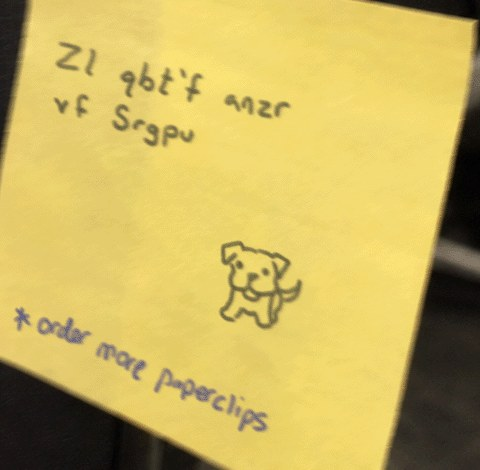

# Hail Caesar

| | |
|---|---|
| **CTF** | DEADFACE CTF 2026 |
| **Category** | Cryptography |
| **Points** | 5 |
| **Author** | @syyntax |
| **Writeup by** | [TheMusk3teers](../../../members.md)<br>[H0ussamCl4p](https://github.com/H0ussamCl4p) · [chaimae098](https://github.com/chaimae098) · [fatimaezzahralag-ship-it](https://github.com/fatimaezzahralag-ship-it) · [imanebouzbiba](https://github.com/imanebouzbiba) · Lyna |

## Challenge

> A Night Veil University faculty member left a sticky note by their computer with a very easy-to-decipher password hint. There's a dog drawn on it, so the hint is probably the dog's name. Submit it as `deadface{dog's name}`.

Files given: `pass_hint.png`

!!! note "Hash mismatch"
    The file on the CDN hashes to `d9876c40…1891642`, not the `79f4e2dc…` given in the challenge. Two separate downloads matched each other, so the published hash is probably just out of date.

## Solution

The note on the monitor reads:

{ width="360" }

```
Zl qbt'f anzr vf Srgpu
```

The title says Caesar. The most common shift is 13 (ROT13), and it works on the first try:

```bash
echo "Zl qbt'f anzr vf Srgpu" | tr 'A-Za-z' 'N-ZA-Mn-za-m'
# My dog's name is Fetch
```

## Flag

!!! flag "Flag"
    `deadface{Fetch}`

## Takeaways

For a Caesar shift, try ROT13 first, then all 25 shifts if it fails.
