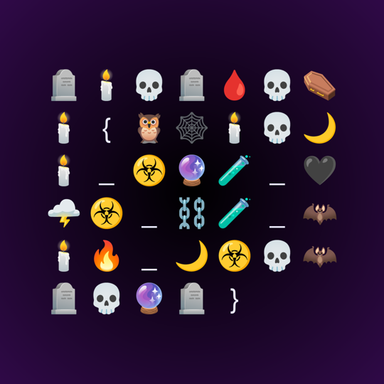

# Infrequent Emojis

| | |
|---|---|
| **CTF** | DEADFACE CTF 2026 |
| **Category** | Cryptography |
| **Points** | 50 |
| **Author** | @Cyan |
| **Writeup by** | [TheMusk3teers](../../../members.md)<br>[H0ussamCl4p](https://github.com/H0ussamCl4p) · [chaimae098](https://github.com/chaimae098) · [fatimaezzahralag-ship-it](https://github.com/fatimaezzahralag-ship-it) · [imanebouzbiba](https://github.com/imanebouzbiba) · Lyna |

## Challenge

> While DoomScrolling, our intel team found a weird coded post with emojis all over it. The patterns suggest it's still English. Can you figure it out? Submit the answer as `deadface{deadface alias}`.

Site given: [DoomScroll](https://doomscroll.dctf.io/), a fake social network.

## Solution

### 1. Find the post

DoomScroll has about 265 posts. Fetching each `/post/N` page and counting emoji points straight at one: post 252 has about 1,400 emoji, and no other post has even 100. The caption and every comment on it are emoji only, with normal spaces and punctuation left in.

### 2. Break the substitution

Each emoji stands for one letter, so it's a substitution cipher. Spaces and punctuation are untouched, so word shapes give it away:

- `☣️💾🕯️` appears everywhere: **the**.
- `📟☣️ 🌩️🌙🕯️🌙 🌙☣️💀🦇🪦💀🔮🪦 🌩️☣️🩸-8 🦉💀🔮💀⛓️🕯️☣️🕯️🔮🌙`: **it uses standard utf-8 parameters**.
- The rest falls out from partly decoded words.

| | | | | | | | | | |
|---|---|---|---|---|---|---|---|---|---|
| 💀 a | ☠️ b | ⚰️ c | 🪦 d | 🕯️ e | 🩸 f | 🦴 g | 💾 h | 📟 i | 🔌 j |
| 📡 k | 🕸️ l | ⛓️ m | 🦇 n | 🖤 o | 🦉 p | 👁️ q | 🔮 r | 🌙 s | ☣️ t |
| 🌩️ u | ☢️ v | 🔥 w | 🥀 x | 🧪 y | 🔏 z | | | | |

```python
KEY = dict(zip("💀☠⚰🪦🕯🩸🦴💾📟🔌📡🕸⛓🦇🖤🦉👁🔮🌙☣🌩☢🔥🥀🧪🔏",
               "abcdefghijklmnopqrstuvwxyz"))

def decode(text):
    text = text.replace("️", "")   # drop emoji variation selectors
    return "".join(KEY.get(ch, ch) for ch in text)
```

The thread is DEADFACE members chatting about the new cipher. spookyboi opens with "the lookup table is live", and others warn that long messages make frequency analysis easy, which is the joke in the title.

### 3. Check the image

The trap: the thread points at spookyboi as the alias, but `deadface{spookyboi}` is **wrong**. The flag is in the post's image, a grid of emoji in the same cipher:

{ width="360" }

Read row by row:

| Row | Text |
|---|---|
| 🪦🕯️💀🪦🩸💀⚰️ | deadfac |
| 🕯️ { 🦉🕸️🕯️💀🌙 | e{pleas |
| 🕯️ _ ☣️🔮🧪 _ 🖤 | e_try_o |
| 🌩️☣️ _ ⛓️🧪 _ 🦇 | ut_my_n |
| 🕯️🔥 _ 🌙☣️💀🦇 | ew_stan |
| 🪦💀🔮🪦 } | dard} |

## Flag

!!! flag "Flag"
    `deadface{please_try_out_my_new_standard}`

## Takeaways

Don't trust the flag format in the description over what the challenge shows you. Always check a post's image as well as its text.
