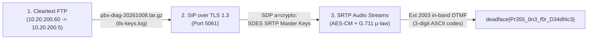

# Don't Leave Me Hanging

| | |
|---|---|
| **CTF** | DEADFACE CTF 2026 |
| **Category** | Traffic analysis / Programming |
| **Points** | 500 |
| **Author** | @Cyb0rgSw0rd |
| **Writeup by** | [TheMusk3teers](../../../members.md)<br>[H0ussamCl4p](https://github.com/H0ussamCl4p) · [chaimae098](https://github.com/chaimae098) · [fatimaezzahralag-ship-it](https://github.com/fatimaezzahralag-ship-it) · [imanebouzbiba](https://github.com/imanebouzbiba) · Lyna |

## Challenge

> Sounds like Deadface are trying to sneak some data out of Aurora Health... but the security is pretty locked down. We suspect that they might be trying to work it from the inside out. The head of security noticed that the traffic for the help desk subnet was flagging for anomalous activity and set the packet capture to us for a set of fresh eyes on the situation.
>
> Submit the answer as `deadface{flag_text}`

Files given: `DontLeaveMeHanging.pcap` (80 MB, SHA256: `93bf96711676fa3675d0bd8729ccdf00ffc80ef4ddcc4e1892dfa1a45f11e6f2`)

## Solution

This one is layered. Each layer gives you the keys for the next:



### FTP: the diagnostics bundle

Almost everything is encrypted: SIP over TLS on 5061 and SRTP between the Asterisk PBX (`10.20.200.5`) and the help desk phones (`10.20.200.21`–`.24`). The exception is a plain FTP session from `10.20.200.60` to the PBX:

- login `mkowalski` / `Aur0ra!Helpdesk26`
- `CWD /var/log/asterisk/diag`, then `RETR pbx-diag-20261008.tar.gz`

We rebuilt the passive data stream (port 40079) to get the tarball. Two files in it matter:

- `tls-keys.log`, an `SSLKEYLOGFILE` with the PBX's TLS 1.3 secrets.
- `pjsip_endpoints.txt`, the endpoint config. Extension `2003` (an Android Linphone, "Sunstalker S14", at `10.20.200.23`) is the only one with `dtmf_mode = inband`. That told us where to look later.

### TLS: SIP signaling

Load the key log in Wireshark or tshark (`-o tls.keylog_file:tls-keys.log`) and the SIP on 5061 decrypts. The SDP in each `INVITE` and `200 OK` has the SRTP master key and salt for the call:

```text
a=crypto:1 AES_CM_128_HMAC_SHA1_80 inline:<base64_master_key_and_salt>
```

### SRTP: the audio

Each stream uses AES-CM with the key its sender put in the SDP. We derived the session keys as in RFC 3711, decrypted the RTP payloads, and turned the G.711 μ-law samples into WAV files.

Extension 2003 gets a call from caller ID "MARGARET OKAFOR". The agent never says a word, and the caller's side is nothing but DTMF tones. Since DTMF is in-band, there are no RFC 4733 event packets. You have to detect the tones in the audio, which we did with Goertzel. The digits come out in groups of three:

```text
100 101 097 100 102 097 099 101 123 080 114 051 053 053 095 048 110 051 095 102 048 114 095 068 051 052 100 102 052 099 051 125
```

Those are decimal ASCII codes:

```python
codes = [100, 101, 97, 100, 102, 97, 99, 101, 123, 80, 114, 51, 53, 53, 95, 48, 110, 51, 95, 102, 48, 114, 95, 68, 51, 52, 100, 102, 52, 99, 51, 125]
print("".join(chr(c) for c in codes))
# deadface{Pr355_0n3_f0r_D34df4c3}
```

## Flag

!!! flag "Flag"
    `deadface{Pr355_0n3_f0r_D34df4c3}`

## Takeaways

When everything is encrypted, look for the one cleartext protocol. Here FTP leaked the TLS key log, TLS gave us the SRTP keys, and `dtmf_mode=inband` told us to listen to the audio instead of looking for telephone-event packets.
