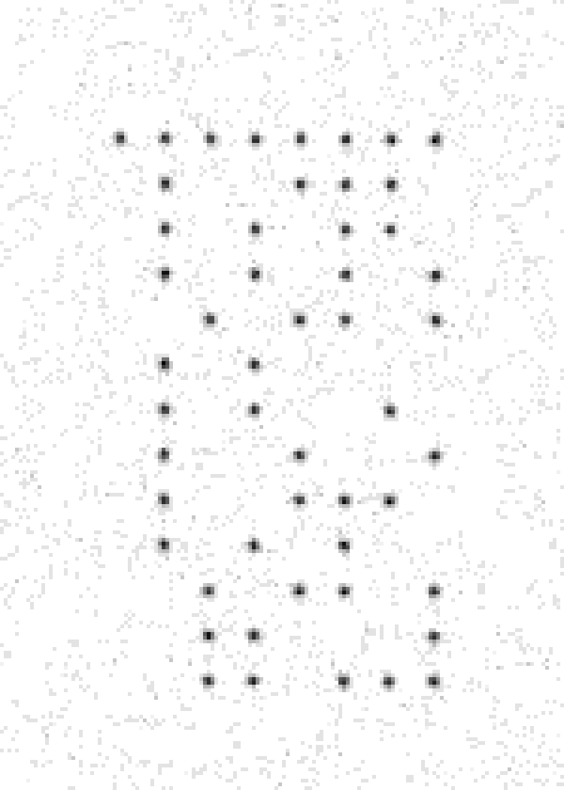

# Conduct Unbecoming

| | |
|---|---|
| **CTF** | DEADFACE CTF 2026 |
| **Category** | Steganography |
| **Points** | 75 |
| **Writeup by** | [TheMusk3teers](../../../members.md)<br>[H0ussamCl4p](https://github.com/H0ussamCl4p) · [chaimae098](https://github.com/chaimae098) · [fatimaezzahralag-ship-it](https://github.com/fatimaezzahralag-ship-it) · [imanebouzbiba](https://github.com/imanebouzbiba) |

## Challenge

> DEADFACE breached Night Veil University and stole internal documents. Find the asset-id that was used to create the recovered document.

Files given: `Doc_20261017_0915.jpg`  
SHA256: `6e7809f4a7893b0a8348195d0009181376ef635d465a2ee4279e78115e44f1ba`

{ width="420" }

## Solution

### 1. Metadata is a dead end

`exiftool` shows only Affinity Photo history and the title `NVU Conduct Notice`. No asset-id.

```bash
exiftool -a -G1 Doc_20261017_0915.jpg
```

### 2. Think printer, not file

The image is a scanned printed letter, and the challenge asks which device *created* it. Many color laser printers add tiny yellow dots to every page, called a Machine Identification Code, that encode the printer's serial number. They are almost invisible on white paper.

To find them, keep only the pixels where blue is slightly lower than red and green. That is faint yellow. They all sit in one small block next to the "Page 1 of 1" footer.

{ width="300" }

### 3. Decode the grid

The dots form a grid 8 columns wide and 13 rows tall. The top row is all dots, a marker. Each row below it is one byte: a dot is `1`, an empty spot is `0`. Read as ASCII, the rows spell the asset-id.

```python
import sys
import numpy as np
from PIL import Image

a = np.asarray(Image.open(sys.argv[1])).astype(int)
r, g, b = a[..., 0], a[..., 1], a[..., 2]
yellow = (r + g) // 2 - b > 8          # faint yellow on white paper

ys, xs = np.nonzero(yellow)
x0, y0 = xs.min(), ys.min()
step = 12                               # dot pitch in pixels
cols = (xs.max() - x0) // step + 1
rows = (ys.max() - y0) // step + 1

grid = np.zeros((rows, cols), int)
for y, x in zip(ys, xs):
    grid[round((y - y0) / step), round((x - x0) / step)] = 1

for row in grid:
    print("".join(map(str, row)))
print("".join(chr(int("".join(map(str, row)), 2)) for row in grid[1:]))
```

```
11111111
01001110  N
01010110  V
01010101  U
00101101  -
01010000  P
01010010  R
01001001  I
01001110  N
01010100  T
00101101  -
00110001  1
00110111  7
```

## Flag

!!! flag "Flag"
    `deadface{NVU-PRINT-17}`

## Takeaways

For a scanned or printed document, look for yellow tracking dots before trying file-based stego tools.
