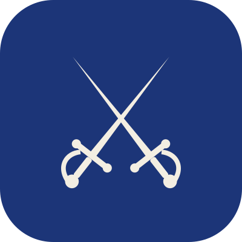

CTF team · Morocco

<h1 class="mk-hero__title">Tous pour un, <em>un pour tous.</em></h1>

We're TheMusk3teers, students from Morocco. We play Capture The Flag competitions as <strong>4Musketeers</strong>, hackathons are next, and our writeups live here.

[Our campaigns](ctfs/index.md){ .md-button .md-button--primary }
[Meet the team](members.md){ .md-button }

Current campaign

17–19 October 2026

### DEADFACE CTF 2026

We ride against DEADFACE this weekend. Writeups go up as soon as the competition closes.

[Follow the campaign](ctfs/deadface-2026/index.md){ .md-button }

What we do

## One team, *every flag counts.*

-   **Jeopardy CTFs**

    ---

    Crypto, forensics, OSINT, web, reversing, pwn. Every member plays.

-   **Writeups**

    ---

    Every solved challenge gets a clear writeup so the next musketeer learns faster.

-   **Hackathons**

    ---

    Coming soon. CTFs first, then we take the same team spirit to building things.

-   **Learning together**

    ---

    Engineering students in cybersecurity and cloud, sharpening our skills one event at a time.

